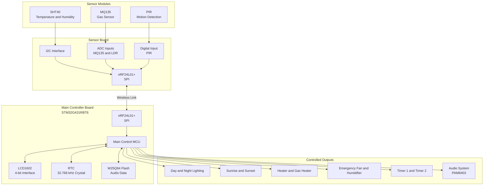
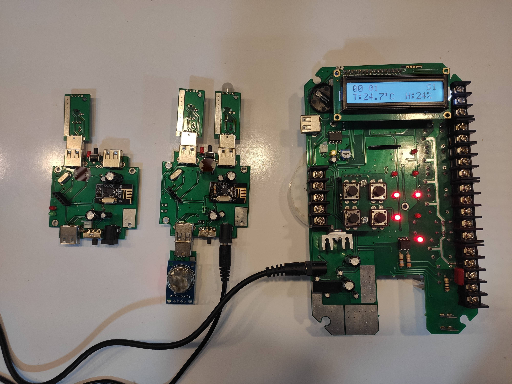
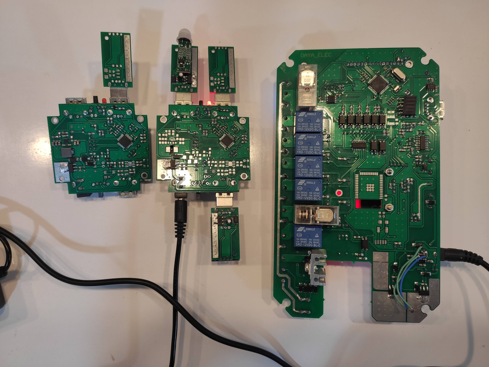

# Z35 Hardware

Hardware design files for the **Z35 Ornamental Bird Room Controller**, developed by Mohammadreza Zourmand using Altium Designer.

## Table of Contents

- [Related Repositories](#related-repositories)
- [Overview](#overview)
- [Hardware Architecture](#hardware-architecture)
- [System Specifications](#system-specifications)
- [Main Controller Board](#main-controller-board)
- [Sensor Board](#sensor-board)
- [Wireless and Adapter Board](#wireless-and-adapter-board)
- [MCU Pin Mapping](#mcu-pin-mapping)
- [Power and Isolation](#power-and-isolation)
- [PCB Specifications](#pcb-specifications)
- [Design Files](#design-files)
- [Planned Improvements and Known Issues](#planned-improvements-and-known-issues)
- [Revision History](#revision-history)
- [Safety Notes](#safety-notes)
- [Gallery](#gallery)
- [License](#license)
- [Credits](#credits)

## Related Repositories

The Z35 project is divided into hardware design and embedded firmware repositories.

| Repository | Description |
|---|---|
| [Z35 Hardware](https://github.com/mzurmand/Z35_Hardware) | Hardware design files, schematics, and PCB layouts. |
| [Main Board Firmware — Collaborator](https://github.com/m-elec76/Z35_main_board) | Firmware repository for the main controller board. |
| [Sensor Board Firmware — Collaborator](https://github.com/m-elec76/Z35_sensor_board) | Firmware repository for the sensor board. |

The firmware repositories are maintained separately from this hardware repository. Repository links and ownership should be verified before publication.

## Overview

The Z35 is an embedded controller designed for small and medium-sized ornamental bird rooms. It combines environmental sensing, wireless sensor communication, lighting control, heating, ventilation, and timer-based functions.

The hardware design consists of three boards:

- **Main Controller Board:** Central control, user interface, real-time clock, external flash, wireless communication, and output control.
- **Sensor Board:** Environmental sensors, analog inputs, motion detection, and wireless communication.
- **Wireless and Adapter Board:** Supporting wireless and interface circuitry.

The design files were created using **Altium Designer 25.5.2 Build 35**.

## Hardware Architecture

*The diagram provides a functional overview. Refer to the schematics for complete electrical connections and pin-to-net assignments.*

## System Specifications

| Feature | Description |
|---|---|
| Main MCU | STM32G431RBT6 |
| Sensor MCU | STM32G030C8T6 |
| Main board clock | 8 MHz external crystal; 32 MHz system clock |
| RTC clock | 32.768 kHz crystal with backup supply |
| Main input supply | 12 V DC |
| Relay coil supply | 12 V |
| Display | LCD1602, HD44780-compatible, 4-bit parallel interface |
| Wireless communication | nRF24L01+ |
| External flash | W25Q64BVSSIG |
| Temperature and humidity sensor | SHT40 |
| Gas sensor | MQ135 |
| Motion sensor | PIR |
| Light sensor | LDR |
| PCB construction | Two layers, 1.6 mm thickness |

## Main Controller Board

The main controller board is based on the STM32G431RBT6 and manages the user interface, sensor communication, timing functions, and controlled outputs.

### Main Features

- LCD1602 user interface.
- Real-time clock with a 32.768 kHz crystal and backup supply.
- nRF24L01+ wireless interface using SPI and an external interrupt signal.
- W25Q64BVSSIG external flash memory for audio-related data.
- PAM8403 audio amplifier circuitry.
- Day/night lighting and sunrise/sunset control.
- Heating, ventilation, humidification, and timer outputs.
- Power and interface isolation in selected circuit sections.

### nRF24L01+ Configuration

The intended firmware configuration includes:

- Data rate: 250 kbps.
- CRC: 2 bytes.
- Address width: 5 bytes.
- Automatic retransmissions: 5 retries.
- Retry delay: 1000 µs.

These values describe the documented configuration and should be checked against the firmware version used in the final system.

### User Interface

The main board uses four push buttons:

| Function | MCU Pin |
|---|---|
| UP | PB4 |
| DOWN | PD2 |
| CLOCK | PB5 |
| MAIN | PB3 |

For the complete output assignments, peripheral connections, and electrical nets, refer to `Sch_Z35.SchDoc` and `PCB_Z35.PcbDoc`.

## Sensor Board

The sensor board uses the STM32G030C8T6 to collect environmental measurements and communicate with the main controller through an nRF24L01+ wireless link.

### Sensor Interfaces

| Component | Interface | Function |
|---|---|---|
| SHT40 | I²C | Temperature and humidity |
| MQ135 | ADC | Gas-sensing signal |
| LDR | ADC | Ambient light measurement |
| PIR | Digital GPIO | Motion detection |
| nRF24L01+ | SPI | Wireless communication |

The sensor modules are designed to connect through USB-A connectors used as physical connectors. These connections should not be assumed to implement standard USB data communication.

### Identified MCU Pin Assignments

| Signal | MCU Pin |
|---|---|
| ADC1 | PA0 |
| ADC2 | PA1 |
| ADC4 / LDR | PA3 |
| I²C SCL | PB8 |
| I²C SDA | PB9 |
| Status LED | PB7 |
| Status button | PB6 |
| Charge Enable | PC7 |
| nRF24L01+ IRQ | PA8 |
| nRF24L01+ CE | PB10 |
| nRF24L01+ CSN | PB11 |
| SPI2 SCK | PB13 |
| SPI2 MISO | PB14 |
| SPI2 MOSI | PB15 |

These are the identified signal assignments. Consult `Sch_Z35_Sensors.SchDoc` and `PCB_Z35_Sensors.PcbDoc` for the complete circuit and net mapping.

## Wireless and Adapter Board

The project includes a separate wireless and adapter board. Its detailed role, connectors, and electrical interfaces should be determined from `Sch_Z35_Wireless_board.SchDoc` and `PCB_Z35_Wireless_board.PcbDoc`.

The GSM, cloud connectivity, and external storage architecture is subject to the planned hardware revisions listed below.

## MCU Pin Mapping

For maintainability and to avoid discrepancies between documentation and the design files, complete pin-to-net assignments are documented in the native Altium schematics.

| Board | Schematic | PCB layout |
|---|---|---|
| Main controller | `Sch_Z35.SchDoc` | `PCB_Z35.PcbDoc` |
| Sensor board | `Sch_Z35_Sensors.SchDoc` | `PCB_Z35_Sensors.PcbDoc` |
| Wireless and adapter board | `Sch_Z35_Wireless_board.SchDoc` | `PCB_Z35_Wireless_board.PcbDoc` |

## Power and Isolation

The current design includes 12 V input power, 12 V relay coils, selected isolated interfaces, and separate circuitry for lighting and audio functions.

Identified components and circuit sections include:

- **B1205S-2WR3:** Isolated DC-DC converter.
- **CA-IS3722HS:** Digital isolator used in an interface section.
- **PC817:** Optocoupler used in the AC zero-cross detection circuit.
- **MOC3061 and BTA16:** Components used in AC lighting control.
- **6N137 and IRFZ44N:** Components in the 12 V sunrise/sunset LED control path.
- **PAM8403:** Audio power amplifier.

The isolation and power circuits require further review. In particular, the GSM interface and the sensor-board power-source selection are listed as known issues below. The presence of an isolation component should not be interpreted as confirmation that the complete circuit meets its voltage, insulation, or safety requirements.

## PCB Specifications

| PCB | Dimensions | Layers | Thickness |
|---|---:|---:|---:|
| Main controller board | 116.21 × 196.02 mm | 2 | 1.6 mm |
| Sensor board | 67.94 × 65.02 mm | 2 | 1.6 mm |
| Wireless and adapter board | 19.94 x 36.96 mm | 2 | 1.6 mm |

Gerber files are not currently included in this repository. The native Altium PCB documents are provided for design review and further development.

## Design Files

The repository includes the native Altium project and design documents.

| File | Description |
|---|---|
| `Z35.PrjPcb` | Main Altium PCB project |
| `Sch_Z35.SchDoc` | Main controller schematic |
| `PCB_Z35.PcbDoc` | Main controller PCB layout |
| `Sch_Z35_Sensors.SchDoc` | Sensor board schematic |
| `PCB_Z35_Sensors.PcbDoc` | Sensor board PCB layout |
| `Sch_Z35_Wireless_board.SchDoc` | Wireless and adapter board schematic |
| `PCB_Z35_Wireless_board.PcbDoc` | Wireless and adapter board PCB layout |
| `Docs/` | Project documentation, photos, and videos, where included |

## Planned Improvements and Known Issues

The following list records the planned hardware revisions and identified issues. These items describe **future changes or work requiring verification**, not features confirmed to be implemented in the current hardware revision.

### 1. Main Controller Board

- **GSM interface voltage and isolation:** The CA-IS3722HS interface appears to be exposed to a voltage that may exceed its rated limits. Review the circuit, verify all operating and transient voltages against the datasheet, and correct the interface before use.
- **Internal GSM module:** The intended design was to use a SIM800C or Quectel M66 module. Remove the external GSM USB-A female connector and redesign the GSM section for an internally integrated cellular module.
- **Cellular cloud connectivity:** Remove the ESP32 from the intended architecture and investigate using the GSM module's cellular data connection to communicate with the cloud. Verify the selected module's data capabilities, firmware requirements, and network compatibility.
- **Input power detection and emergency power switching:** The existing `DC Input Selector` circuit has a problem in detecting the input supply and switching between the main 12 V supply and the backup battery. Review and redesign this circuit. The HJR-4102E-L-12V relay has been investigated as a candidate for switching between the two 12 V sources; its suitability, contact ratings, coil drive, and switching behavior still need verification.
- **nRF24L01+ IRQ pull-up:** Add a 10 kΩ pull-up resistor to the nRF24L01+ IRQ signal, after confirming the required logic levels and interrupt configuration.
- **Multicolor user-interface LED:** Add a multicolor LED controlled by the STM32G4 and place it beneath the four push buttons to improve the appearance and provide controllable visual status indication.
- **GSM antenna, SD card, and SIM card placement:** Review the main-board layout and connector arrangement for the GSM antenna, SD card, and SIM card. Determine suitable footprints and mechanical placement for the final integrated design.
- **Data-logger memory:** Prioritize an SD/MMC-compatible storage solution for the data logger. Investigate QPI memory access if technically feasible for the selected memory device and interface. The final storage technology and interface remain to be selected.
- **GSM audio input:** Investigate connecting the GSM module's microphone/audio input to a suitable audio-capable interface on the STM32G4 system, enabling the intended recorded-voice interaction with the user when required. Confirm the module's audio interface requirements and the MCU's actual peripheral capabilities before selecting the implementation.
- **GSM power supply:** Investigate a buck-boost regulator, such as the TPS63070RNMT, for the GSM power supply. Validate the required voltage range, peak current, transient response, thermal performance, and power-source conditions before finalizing the design.

### 2. Sensor Board and Sensor Modules

- **Status LED:** Replace the current sensor-board status LED with a three-pin, two-color LED to improve visual indication of sensor and board status.
- **MQ135 and PIR voltage dividers:** Review and correct the resistor-divider circuits associated with the MQ135 and PIR signals. Verify output voltage ranges and compatibility with the STM32G030C8T6 inputs.
- **PIR module placement:** Move the PIR sensor to the back side of its module PCB, subject to mechanical clearance and confirmation that the sensor's field of view is not obstructed.
- **MQ135 mounting:** If practical, redesign the relevant module so that the MQ135 sensor can be soldered directly onto its PCB.
- **Sensor-board power-source selection:** Review and correct the power-source selection circuit so that the charging circuit operates as intended. Verify source selection, charging behavior, and protection requirements.
- **Sensor-board heatsink:** Increase the heatsink size on the sensor module as much as practical, subject to available space, component clearance, and thermal validation.
- **10 µF, 50 V capacitor mounting:** Redesign the footprint or component placement so that the capacitor can be mounted horizontally and positioned away from heat sources, where the selected component and PCB clearance allow it.

### 3. Verification Before Release

Before producing a revised PCB or manufacturing files:

- Verify the corrected GSM isolation and power circuits against component datasheets.
- Test switching between the main 12 V supply and backup battery under realistic loads.
- Verify cellular connectivity and cloud communication with the selected GSM module.
- Confirm SD/MMC or other selected storage compatibility and data-logging reliability.
- Test sensor input voltage ranges and the revised charging circuit.
- Validate thermal performance and mechanical clearances.
- Update the schematics, PCB layouts, BOM, and design documentation to match the approved changes.

## Revision History

| Revision | Description |
|---|---|
| Current documented design | Initial Z35 hardware design files |
| Planned revision | GSM integration, power switching, data logging, user-interface improvements, sensor-board corrections, and thermal/mechanical updates |

The planned revision has not been represented as completed. Update this table when the corresponding changes have been implemented and verified.

## Safety Notes

- The design contains circuits intended to control mains-powered loads. Mains-voltage circuitry requires appropriate isolation, creepage and clearance distances, protection, enclosure design, and qualified review.
- Do not assume the current power-source selection, GSM isolation, or output circuits are safe for production without testing and verification.
- Check all component absolute-maximum ratings and operating conditions before applying power.
- Verify the final design and applicable safety requirements before connecting the controller to real equipment.

## Gallery

| Main & Sensor (Top) | Main & Sensor (Bottom) |
| :---: | :---: |
|  |  |

| Main Board | Sensor Board |
| :---: | :---: |
|  |  |

### Video Demo

## License

This project is distributed under the **Apache License 2.0**. See the [`LICENSE`](LICENSE) file for details.

## Credits

- **Hardware Designer:** Mohammadreza Zourmand <mzselec@gmail.com> — custom 2-layer PCB, mains-isolated
- **Firmware Author:** Mohammadali Abbasi <m.elec76a@gmail.com> — designed and implemented the complete firmware (FreeRTOS architecture, all application tasks, wireless protocol, UI state machine, actuator control)

The main-board and sensor-board firmware are maintained in separate repositories linked above.